<div align="center">


# AgriTrade SME

**A ledger-first app for Myanmar commodity traders: sell, buy, and the maths does itself.**


<br />

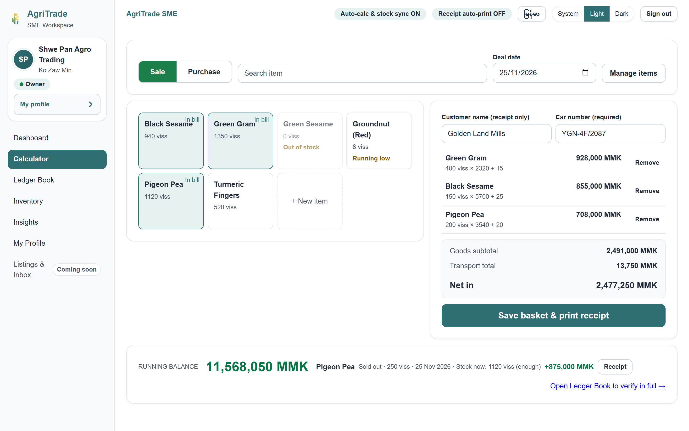

<sub>The Calculator: one basket, live totals, one receipt.</sub>

<br />

> 📌 **This is a showcase repository.** It contains the write-up and screenshots only.
> The source code is private. All screenshots use made-up demo data.

</div>

---

## Table of Contents

- [Motivation](#motivation)
- [Features](#features)
- [Architecture](#architecture)
- [How It's Built](#how-its-built)
- [Technical Highlights](#technical-highlights)
- [Try It](#try-it)
- [Screenshots](#screenshots)
- [Roadmap](#roadmap)
- [License](#license)

---

## Motivation

- Small agri traders still keep paper ledgers and hand-held calculators
- Beans, sesame, pulses: many items, many prices, transport on top
- Mistakes in the maths cost real money
- Users are **not technical**, often on a phone, often Burmese-first

**AgriTrade turns one basket into one receipt, one ledger, and live stock.**

Units are **viss**. Money is **MMK**.

---

## Features

| | |
|---|---|
| 🧮 **Basket Calculator**<br/>Multi-item sale or purchase, transport per viss, live totals, one printable receipt | 📒 **Ledger Book**<br/>Every sale and purchase in one dated book. Period views, search, filters, CSV export, bulk entry |
| 📦 **Automatic Inventory**<br/>Stock moves with every trade. Low-stock and out-of-stock alerts, viss-per-bag view | 📊 **Insights**<br/>Money flow by month, stock value, sales and transport per commodity |
| 🧾 **Receipts**<br/>Grouped receipt with customer and car number. Reprint any old record | 👥 **Owner and Cashier roles**<br/>Cashiers join with a shop code. The owner approves them |
| 🛡️ **Admin approval**<br/>New owners wait for the platform admin to approve or decline | 🔐 **Safe sign-in**<br/>Myanmar phone checks, easy passwords refused, lockout after repeated failures |
| 🌐 **Burmese and English**<br/>One tap to switch. Light, dark and system themes | 📱 **Installable PWA**<br/>Works on phones. Tables turn into cards on small screens |

---

## Architecture

One Cloudflare Worker serves both the API and the app.

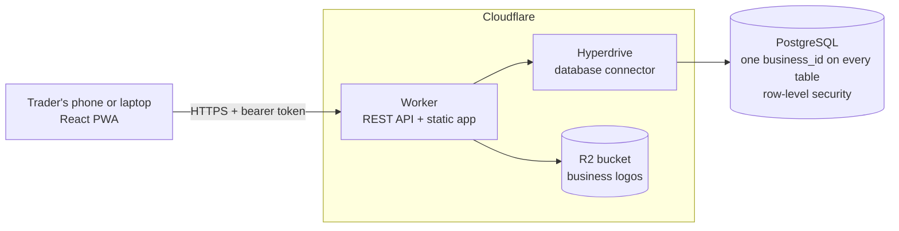

Every request runs the same three gates before any business logic:

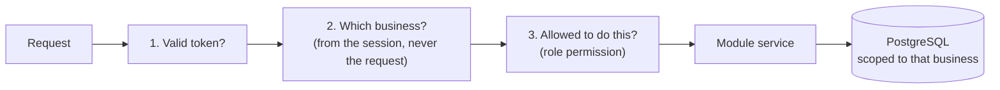

---

## How It's Built

A monorepo with two apps and a modular backend.

```text
agritrade/
├── apps/web/     # React 19 PWA (Vite, TypeScript, React Router)
└── apps/api/     # One Worker, many modules, one database
    ├── auth        # sign-in, lockout, tokens, registration, approvals
    ├── business    # profile, team, shop code, logo
    ├── ledger      # entries, running balance, edit/delete, bulk, CSV
    ├── inventory   # stock, thresholds, bag sizes
    ├── calculator  # basket totals, grouped save
    ├── receipts    # receipt payloads
    ├── insights    # money flow and per-commodity numbers
    └── admin       # approvals, suspend, announcements, audit log
```

- 23 database migrations, applied in order
- Secrets live in the platform, never in the repo

---

## Technical Highlights

- **One money formula.** The server owns every total. The Calculator preview and the saved ledger use the same code, so they always agree
- **No overselling.** A sale that needs more stock than the shelf holds is refused, with a plain message
- **Multi-tenant by design.** `business_id` on every table, plus row-level security as a second lock
- **Safe retries.** Saves are idempotent, so a double tap or a flaky network does not double-book a sale
- **Workers-ready.** A fresh database pool per request, closed after the response. A shared pool hung in production
- **Careful auth.** PBKDF2-SHA-256, 15-minute lockout after 5 failed attempts, short-lived access tokens with revocable refresh tokens
- **Admin without snooping.** The admin console shows account details and counts only, never ledger or stock rows
- **Same rules on both sides.** The form and the server share one set of field checks, so the server never trusts the browser
- **Tested.** 687 API tests and 390 web tests, including property-based tests for money maths and lockout
- **Pure view-models.** Screen logic lives in small pure functions that are easy to test without a browser

---

## Try It

The app is live. Sign-up needs admin approval.

- 🔗 **Live app:** <https://agritrade.kmtlabs.workers.dev>
- Want a look inside? Create an account, or message me for a demo login

Source code is private, so there is nothing to clone or install here.

---

## Screenshots

All screens use fake demo data.

<table>
  <tr>
    <td width="50%">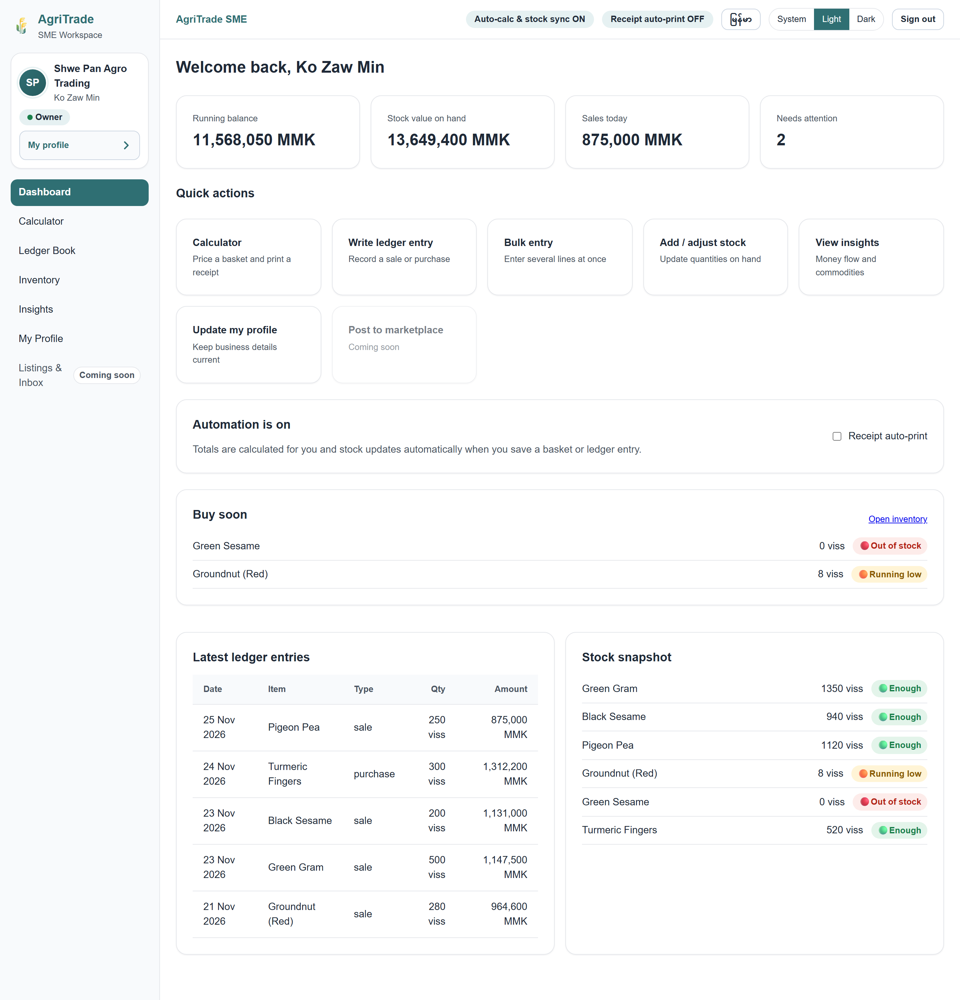<br /><sub><b>Dashboard</b>: balance, stock value, today's sales, what to buy soon</sub></td>
    <td width="50%">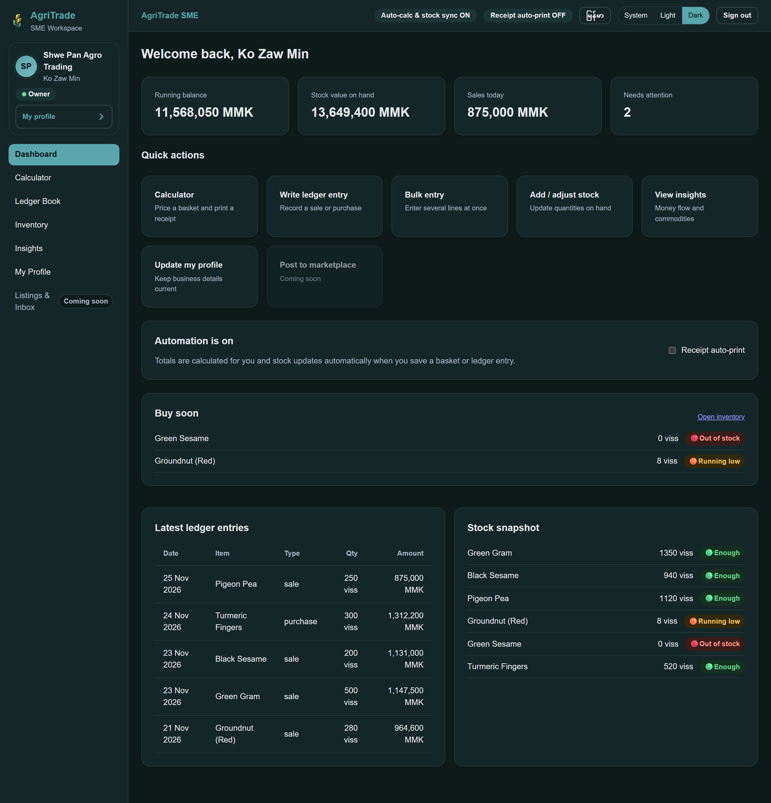<br /><sub><b>Dark mode</b>: light, dark or follow the device</sub></td>
  </tr>
  <tr>
    <td width="50%">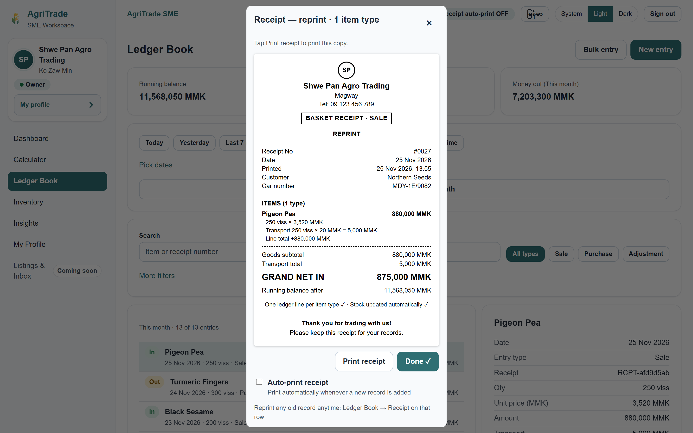<br /><sub><b>Receipt</b>: reprint any record from the Ledger Book</sub></td>
    <td width="50%">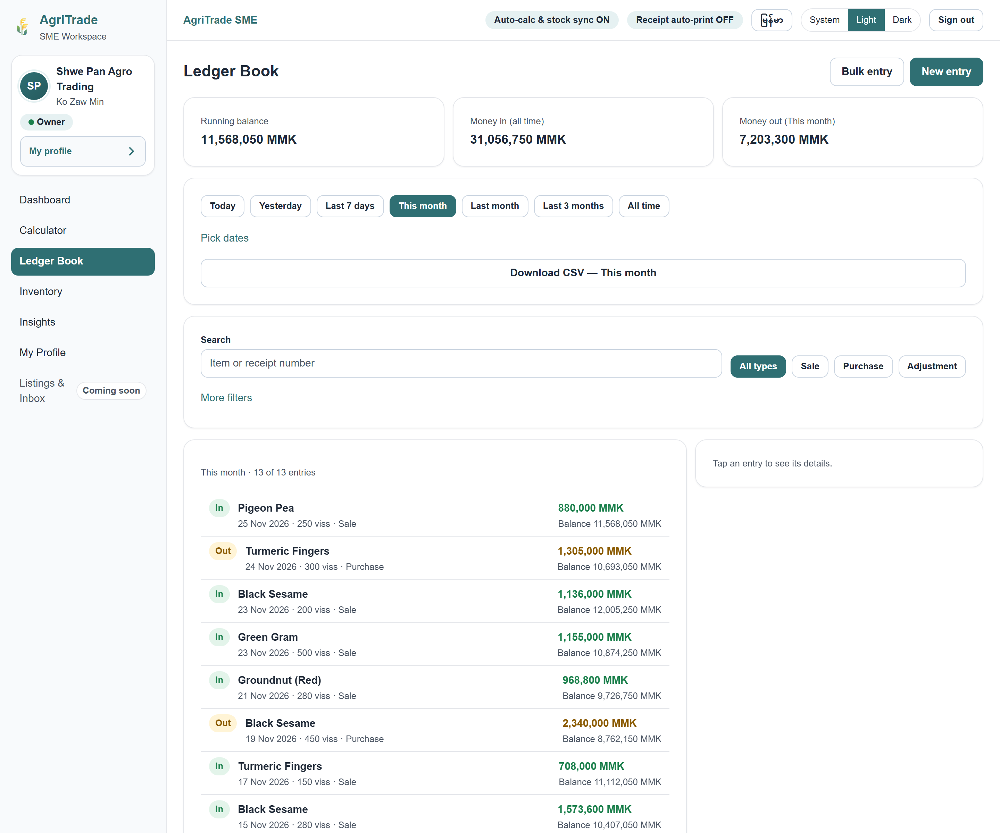<br /><sub><b>Ledger Book</b>: period views, search, running balance</sub></td>
  </tr>
  <tr>
    <td width="50%">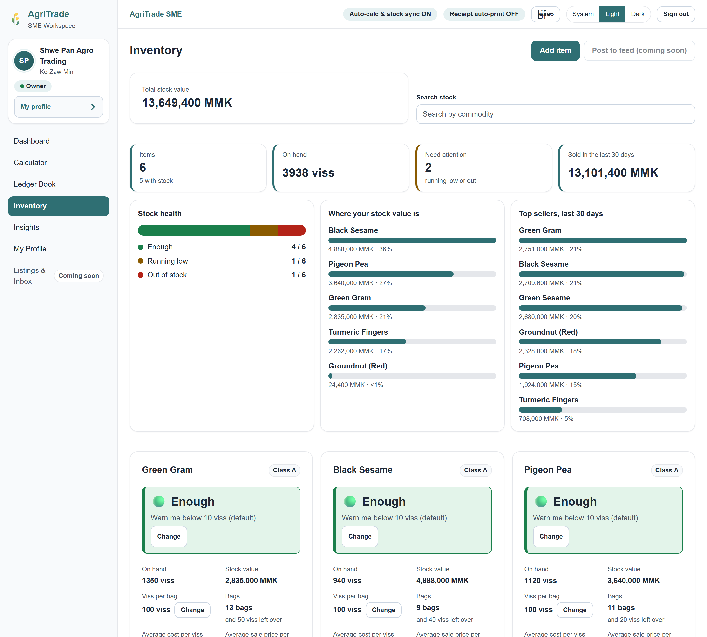<br /><sub><b>Inventory</b>: stock health, value, top sellers, bags</sub></td>
    <td width="50%">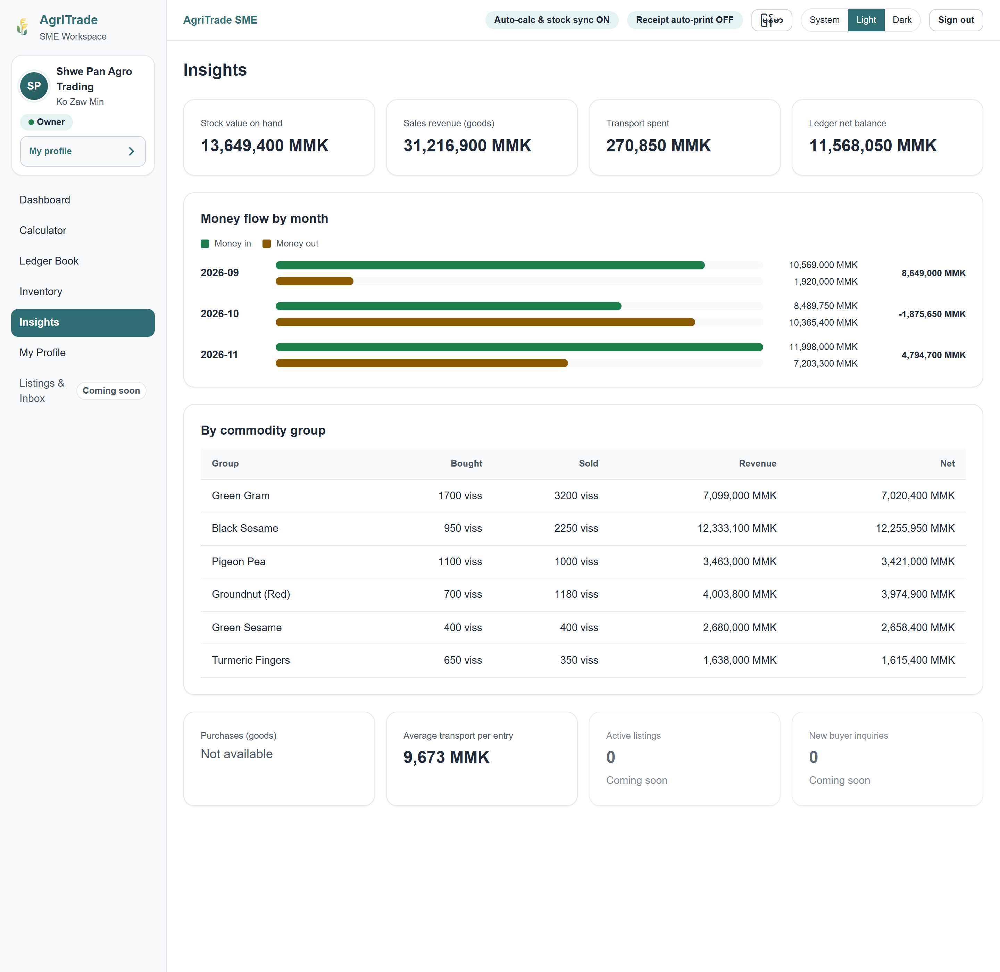<br /><sub><b>Insights</b>: money flow by month and by commodity</sub></td>
  </tr>
  <tr>
    <td width="50%">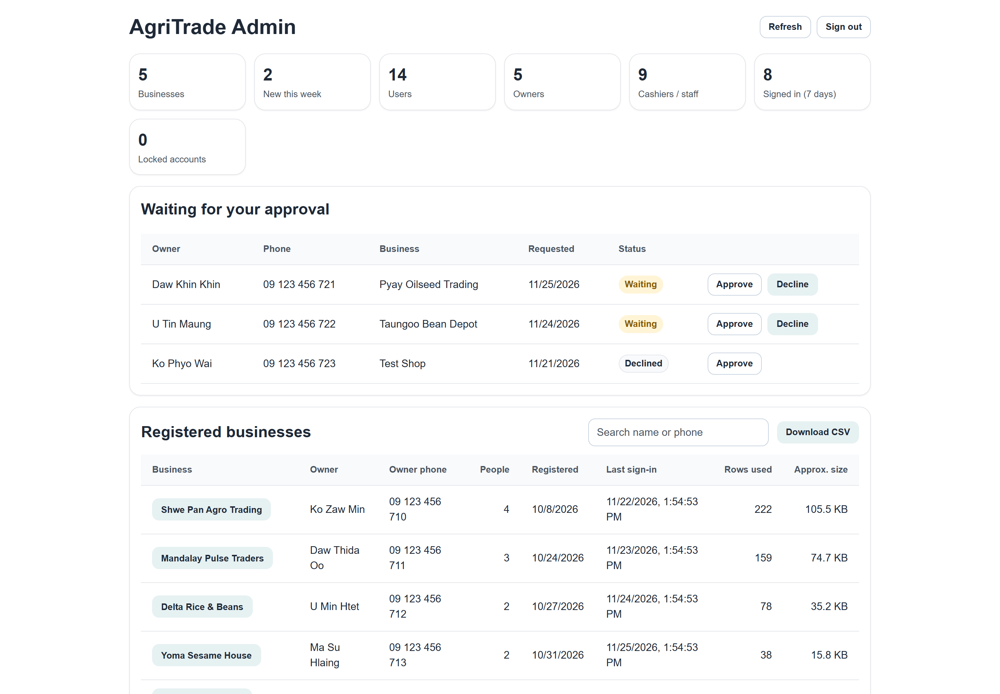<br /><sub><b>Admin</b>: approve or decline new owners</sub></td>
    <td width="50%">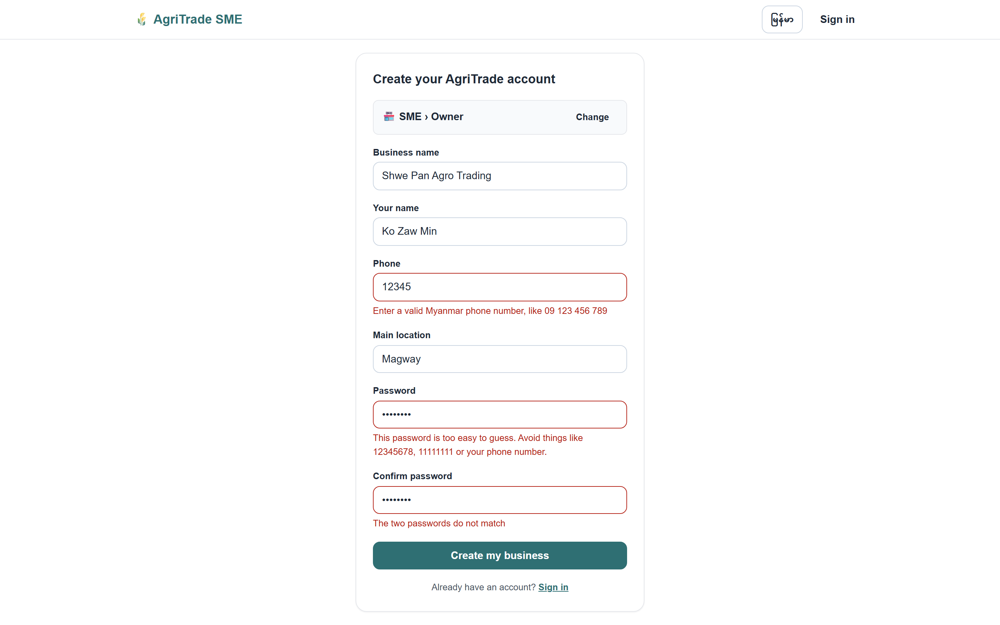<br /><sub><b>Sign-up checks</b>: Myanmar phone, easy password, confirm password</sub></td>
  </tr>
  <tr>
    <td width="50%">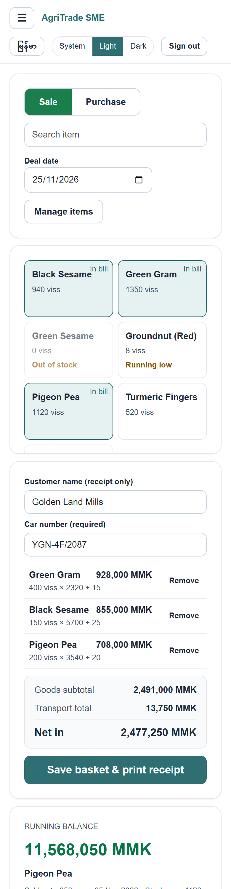<br /><sub><b>On a phone</b>: the Calculator, same bill</sub></td>
    <td width="50%">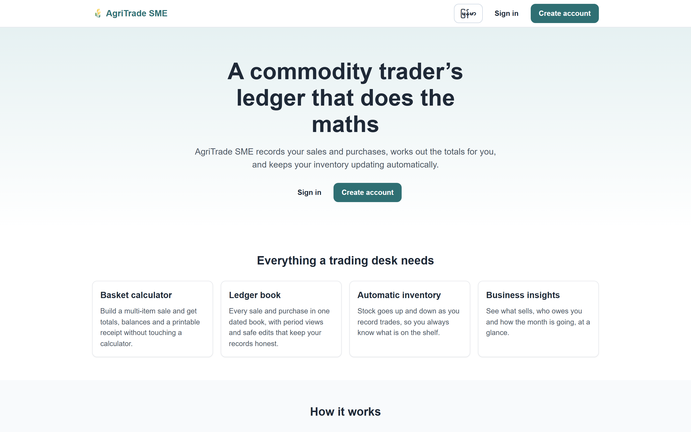<br /><sub><b>Landing page</b>: public, before sign-in</sub></td>
  </tr>
</table>

<sub>Screenshots were taken from the real app running against a demo data set. The Calculator bill is pre-filled, the receipt is a reprint, and the sign-up form is filled with wrong values on purpose to show the checks.</sub>

---

## Roadmap

Ideas, not promises.

- [x] Calculator, Ledger Book, Inventory, Insights, receipts
- [x] Owner and Cashier roles with shop code
- [x] Low-stock alerts and viss-per-bag view
- [x] Admin console and owner approval
- [x] Burmese and English
- [ ] Marketplace: listings and inbox (shown as "coming soon" in the app)
- [ ] Stock history for each item
- [ ] Stock counts (cycle counts)
- [ ] Batches and stock aging
- [ ] More than one store per business

---

## License

© AgriTrade. All rights reserved.

This repository is a presentation of the project. The source code is private and is not licensed for reuse.
